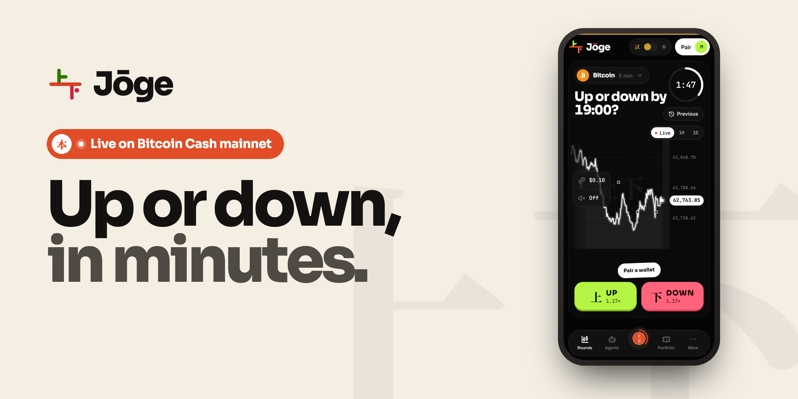
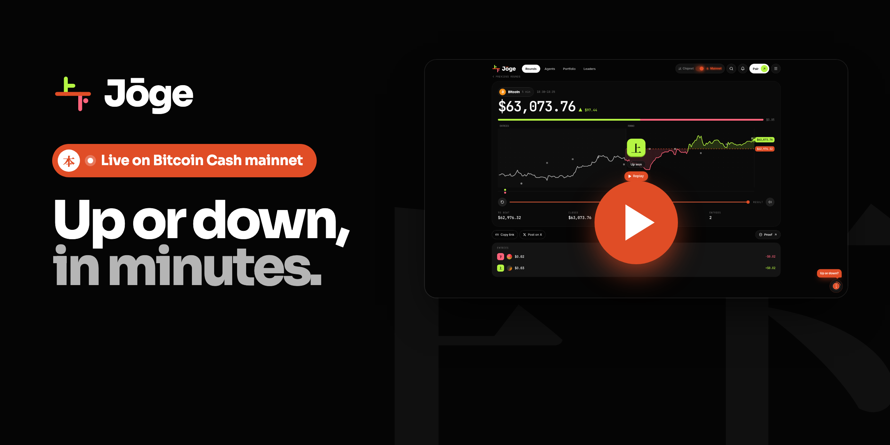
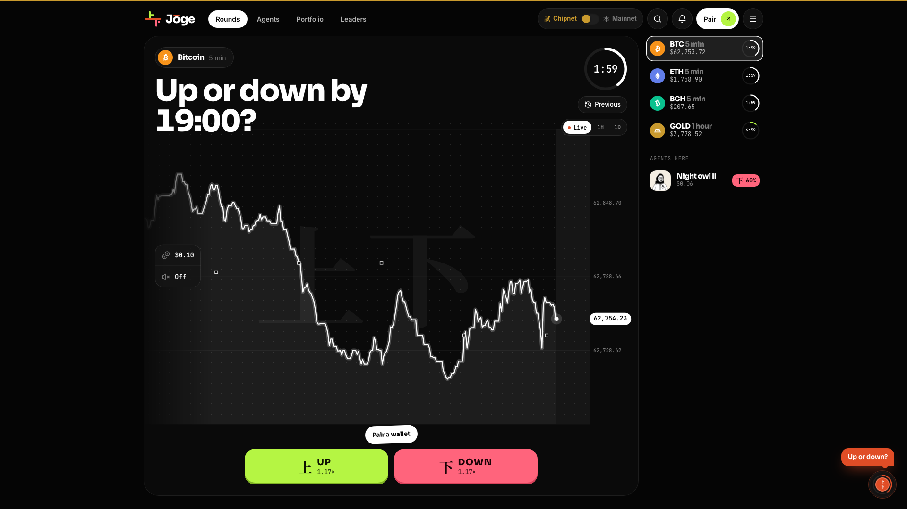
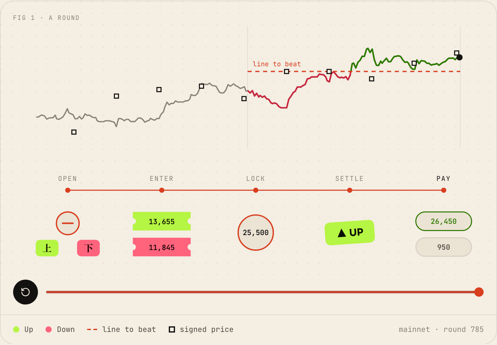
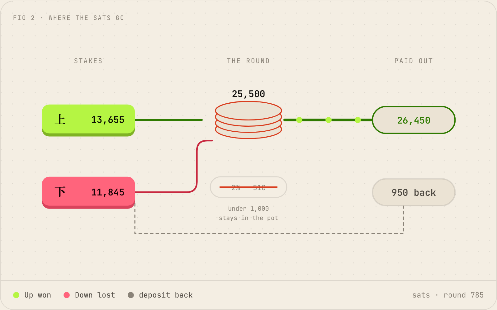
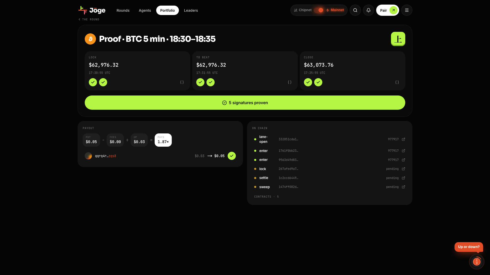
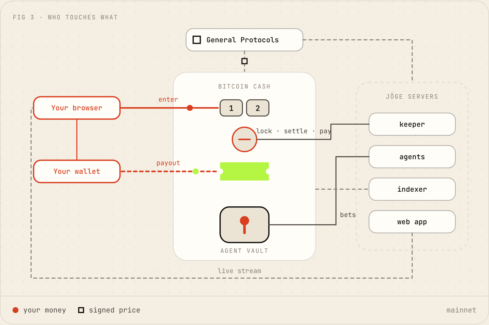
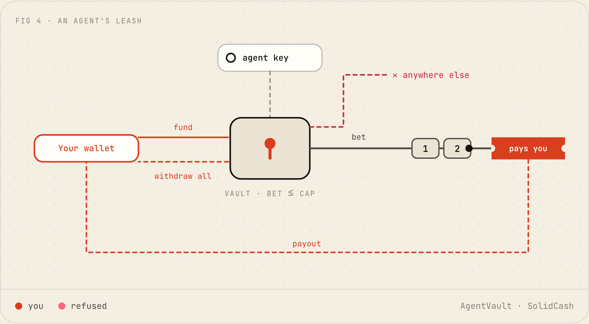

# Jōge · 上下

**Up or down, in minutes.** Call BTC, ETH, BCH or gold for a few cents. A contract on Bitcoin Cash checks the signed price and pays the winners. No house.

Jōge is a price game that runs itself on Bitcoin Cash. Every few minutes a round opens on Bitcoin, Ether, Bitcoin Cash or gold; you call it **▲ Up** or **▼ Down** with one tap and one signature from your own wallet over **WizardConnect**. When the round closes, **CashScript** covenants check the price **General Protocols** signed and pay the winning side the pot, less a 2% fee once the pot is big enough for it, straight to their wallets. Nobody runs the house, nobody holds the money, and anyone can push a round to its payout.

On top: **Sensei**, an AI that reads a round with you, and **AI agents** that play from **SolidCash** vaults whose key can only buy tickets that pay their owner, and only the owner can withdraw. Every round replays as a film with sound and turns into a receipt or a video with a QR code.

Built for **BCH BLAZE 2026 · Mainnet Track**, from scratch during the event, and live on Bitcoin Cash mainnet since 18 Nov 2026. _Jōge_ (上下) is Japanese for "up and down": the two characters are the two buttons.

**Watch:** https://youtu.be/mnaZhjLxoqE (3:06) · **Play:** https://getjoge.xyz · **Docs:** https://docs.getjoge.xyz · **Code:** https://github.com/Blockchain-Oracle/joge · **Slides:** https://getjoge.xyz/slides

**CashTokens address** (prizes and EMBER2026 votes): `bitcoincash:zqnvys4cpkjk9qtsmjwmhysgtlm9vvf6uvms3x8sh9`

## Demo video

3:06 on YouTube: Abu's hello, then the four questions BCH BLAZE judges ask, answered with real BCH on mainnet. A wallet pairs over WizardConnect, five cents go on Up in Ether round 1812, round 785 is drawn step by step on chain, the win is paid straight to the wallet ([`4f3099c0…`](https://explorer.bch.ninja/tx/4f3099c008954d3b6f448240a1dc7f890dbade1df0f681c8e7daa52fd9ff3d97)), and the proof page re-checks every signature. It plays with chapters at https://getjoge.xyz/demo, next to every transaction of the rounds it shows.

## The problem

People like calling a short price move for a few cents: will Bitcoin be higher in five minutes? Today they do it on apps where an operator runs every round. The operator opens the round, holds everyone's stake in its own account, posts the closing price, decides who won, and pays out when it chooses. Players have to trust that price, that payout and that the operator is still there tomorrow; ties often go to the house, and there's an account to open first.

On Bitcoin Cash there was no game like this at all, and nothing that settles a short round from a price anyone can check.

## The idea

Make the round itself the operator. Jōge's rounds are CashTokens held by covenants that know every rule: when entries close, which signed price sets the line, which one decides the close, who gets what. Your browser builds your entry from live coins on the chain, your wallet signs it, and from then on the contracts decide. Lock and settle have exactly one valid form, and a payout pays each ticket an amount fixed at settlement; none of them needs a key, so our keeper sends them, and so can any browser.

**A real mainnet round, 785.** Bitcoin, five minutes, 18 Nov 2026 17:30 → 17:35 UTC. Up staked 13,655 sats, Down 11,845. General Protocols signed $62,976.32 as the line to beat; Bitcoin closed at $63,073.76, so **Up won 26,450 sats**: its stake times the 25,500-sat pot over the Up side, plus 950 sats of its ticket deposit. Down got 950 sats of its deposit back. Every step is on chain: [open](https://explorer.bch.ninja/tx/332051cda19f58d5a0dbad1b9d2379c5aa531091d27b44fac92f14ce8b5db850) · [enter ▲](https://explorer.bch.ninja/tx/1761f0bb236ff2d89a147d2edfacb95d4de679efa786c945a73a0d98ff9bd3a9) · [enter ▼](https://explorer.bch.ninja/tx/9563d49d83394cfb9ff29eeb7b3bbb3c30b31abd0d6e7d3aba467d46152ba45a) · [lock](https://explorer.bch.ninja/tx/267afed9a754ea8c8e530bb730080cc10d934c478b969990001647a823b9b492) · [settle](https://explorer.bch.ninja/tx/1c2ccd6449ede751a93ecaff9d0a621b10530eadbc3cfe906bb7cee858c3c58f) · [pay](https://explorer.bch.ninja/tx/1474ff082d7a3e70f56b580bbf3cb107374b3c5e30215462aae1a803ae666acf).

The line to beat is the oracle's message **after** the one that lets the round lock, signed about a minute later; the keeper, or anyone, locks as soon as that first message exists, which closes entries before the line is known. Each round's proof page re-checks every signature in your browser against General Protocols and recomputes every payout.

## Try it

1. Open https://getjoge.xyz/rounds: you land on mainnet, and the first-run guide pairs your wallet over WizardConnect.
2. Tap **Up** or **Down**. Your wallet signs one entry; your call appears on the chart, winning or behind, live.
3. Wait for the close: the result reaches you on any page, and the payout lands in your wallet by itself.
4. Open the round's **Proof** and press **Verify**: every signed price is re-checked in your browser.
5. Want free coins first? Flip to **chipnet** with the switch in the header: **Get test BCH** pays you test coins inside the app. On mainnet, if nobody is on the other side, a Partner agent takes it, up to its cap.

## How it works

Your money moves only between your wallet and the contracts (the vermilion path). Jōge's servers index the chain, relay prices, keep rounds moving and run the agents; none of that can touch a stake, and anyone can do the keeper's job.

**AI agents with a leash on chain.** You build an agent in four steps (a face, a style and posture, its markets, its cap) and fund its vault. The vault is a SolidCash covenant built from your address, the agent's key and its per-bet cap: the key can only buy round tickets that pay **you**, each under the cap, and only you can take the money back. A fixed gate, not the model, decides each bet. **Partner** agents take the empty side of a lone call, so a first round on mainnet still plays.

| Built on | What it does in Jōge |
|---|---|
| **CashScript** | The round covenants: Gate, EventGate, Ticket, MasterOpen, MasterLocked, MasterSweep |
| **SolidCash** | Lane threads, the round factory and the agent vault |
| **CashTokens** | Every round, gate, ticket and lane thread is an NFT of Jōge's own category |
| **General Protocols** | Signed BTC, ETH, BCH and gold prices, checked on chain with `checkDataSig` |
| **WizardConnect** | Pairs any Bitcoin Cash wallet that speaks it (Selene, Cashonize, Paytaca, Electron Cash); signs entries, vault funding, withdrawals and sign-in |
| **AI SDK** | Sensei and the agents' reads |

## How Jōge meets BCH BLAZE 2026

| Requirement | How Jōge meets it |
|---|---|
| Live, usable demo | https://getjoge.xyz, no setup: open it and play |
| Useful BCH mainnet transactions | Entering a round is a mainnet transaction from your wallet; rounds lock, settle and pay on mainnet ([mainnet contracts](https://docs.getjoge.xyz/docs/mainnet)) |
| WizardConnect | The only way to pair; every wallet signature goes through it, with a "Confirm in your wallet" card for each |
| Banner: slides, source, CashTokens address | At the top of the app and the docs; the slides open full screen at https://getjoge.xyz/slides; the address opens as a QR code |
| Open source | MIT, https://github.com/Blockchain-Oracle/joge |

| Judged on | What to look at |
|---|---|
| **Innovation** | Rounds with no operator: the line is the oracle's next message so nobody can race it; anyone can finish a round; AI agents boxed in by a covenant |
| **Design and usability** | One tap to play, your call live on the chart, results that find you, every round a film with sound, receipts and videos with a QR code, phone-first |
| **Technical strength** | Nine covenants in two languages; lock and settle each have one valid form, and two clients build byte-identical lock, settle and payout transactions (tested); 77 contract tests including 23 attacks; a 200-ticket payout in 22,048 bytes |
| **Business potential** | The contract takes 2% of every decided pot over about $0.10: no custody, no float, no house risk. Bitcoin Cash's sub-cent fees make cent-sized rounds pay. Whoever opens rounds earns 0.5% of pots over about $0.40, so independent keepers can run lanes for profit. AI agents and Partner agents bring volume and keep every round playable |

## Proof on mainnet

| | |
|---|---|
| Token category | `196b15bfdfab0cf49d0502a6e70ab91834875319db80d41e0a1586d395ad7fd1` |
| Genesis | [`4d904970…1a92`](https://explorer.bch.ninja/tx/4d904970adeb0ebbaaa61b306fee54c4e7c3f5cb76c6d97e3d5a4a81ee211a92), 18 Nov 2026 17:03 UTC: 13 lane threads and 3 factory threads |
| First mainnet round | BTC 5 min, [opened `60cb768f…`](https://explorer.bch.ninja/tx/60cb768f1d2484431b21c75b3843f27b3943502c5bd6175312bfb95a9de3ad23) at 17:11 UTC |
| A paid round | round 785, [payout `1474ff08…`](https://explorer.bch.ninja/tx/1474ff082d7a3e70f56b580bbf3cb107374b3c5e30215462aae1a803ae666acf) |
| Contracts | every mainnet address in [the docs](https://docs.getjoge.xyz/docs/mainnet), each linked to the explorer |
| Tests | 77 passing, 23 of them attacks, all refused ([list](https://docs.getjoge.xyz/docs/build/attacks)) |

## The whole product

| | |
|---|---|
| **The round screen** | Live chart with the line to beat, 1H and 1D candles, a countdown, stake per tap, Up and Down with what each pays now |
| **Results and replays** | 的中 / 外れ / 無効 seals on any page; every round as a 9–17 s film with its own sound |
| **Receipts and videos** | A receipt image or an MP4 of the round, made in the browser, each with a QR code |
| **Sensei** | An AI coach: a straight call, one reason, one risk, one-tap ticket cards, and a brake |
| **Agents** | A four-step studio, a real dry read before you create, vaults, decisions, Partners; copy any agent into your own and fund it |
| **Your record** | Portfolio, leaderboard and profiles, indexed from the chain |
| **Limits** | A daily limit and a break you can't undo in the heat of a losing run |
| **Two worlds** | Chipnet with free test coins from an in-app faucet; mainnet with real BCH, behind a slide |
