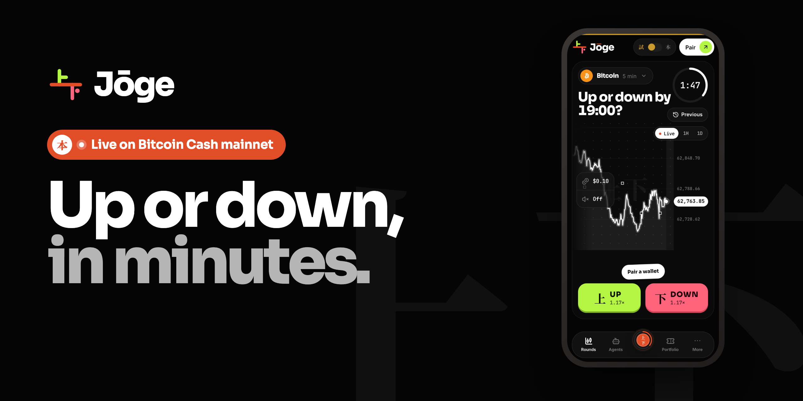
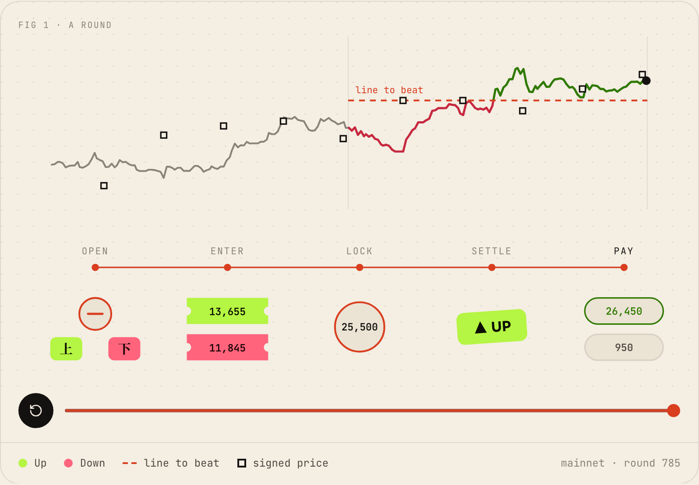
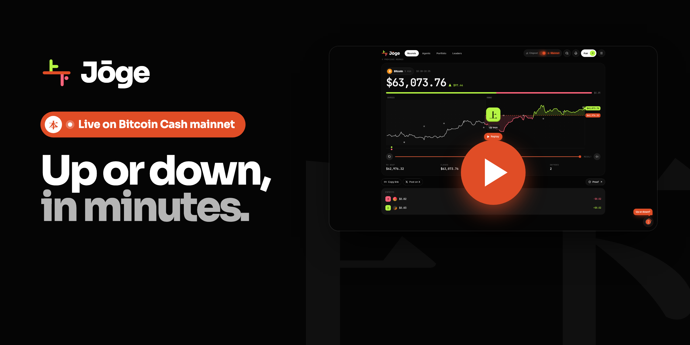
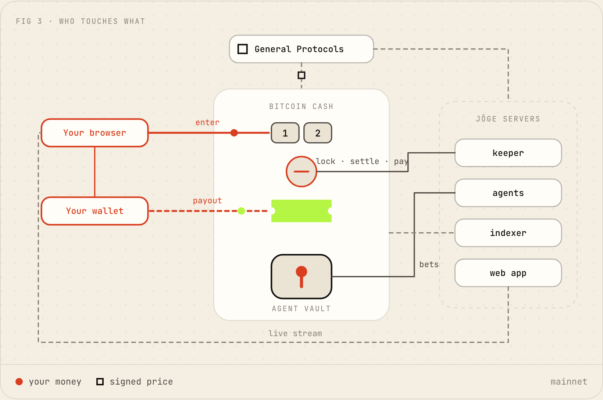
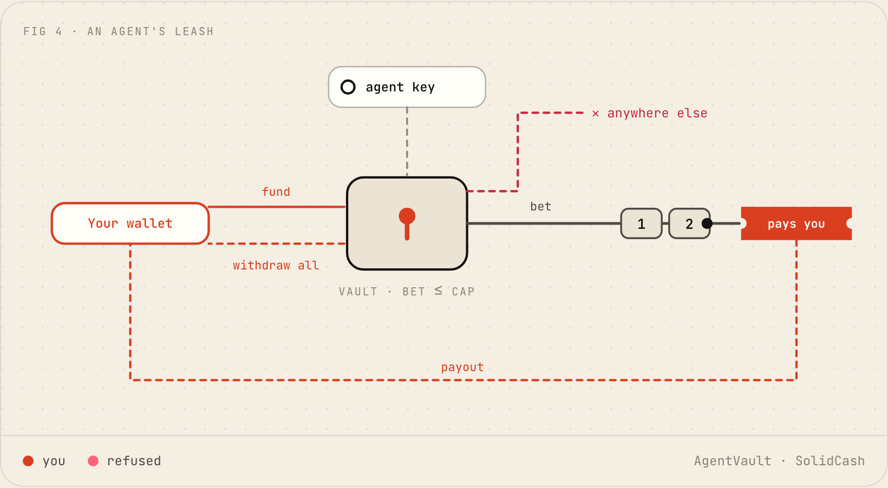

<p align="center">
  <a href="https://getjoge.xyz">
    <picture>
      <source media="(prefers-color-scheme: light)" srcset=".github/assets/banner-light.png" />
      
    </picture>
  </a>
</p>

<h1 align="center">Jōge · 上下</h1>

<p align="center"><b>Up or down, in minutes.</b><br />Call BTC, ETH, BCH or gold for a few cents. A contract on Bitcoin Cash checks the signed price and pays the winners. No house.</p>

<p align="center">
  <b><a href="https://getjoge.xyz">Play Jōge</a></b> ·
  <b><a href="https://docs.getjoge.xyz">Docs</a></b> ·
  <b><a href="https://explorer.bch.ninja/tx/4d904970adeb0ebbaaa61b306fee54c4e7c3f5cb76c6d97e3d5a4a81ee211a92">Mainnet genesis</a></b> ·
  <b><a href="https://getjoge.xyz/slides">Deck</a></b>
</p>

Jōge is a price game that runs itself on Bitcoin Cash. Every few minutes a round opens on Bitcoin, Ether, Bitcoin Cash or gold; you call it <b>▲ Up</b> or <b>▼ Down</b> with one tap and one signature from your own wallet over **WizardConnect**. When the round closes, **CashScript** covenants check the price **General Protocols** signed and pay the winning side the pot, less a 2% fee once the pot is big enough for it, straight to their wallets. Nobody runs the house, nobody holds the money, and anyone can push a round to its payout.

On top: **Sensei**, an AI that reads a round with you, and **AI agents** that play from **SolidCash** vaults whose key can only buy tickets that pay their owner, and only the owner can withdraw. Every round replays as a film with sound and turns into a receipt or a video with a QR code.

**Built for BCH BLAZE 2026 · Mainnet Track.** Built from scratch during the event: work began 16 Nov 2026 and the repository was first pushed on 18 Nov. Live on Bitcoin Cash mainnet since 18 Nov 2026 ([how it meets the hackathon](#how-jōge-meets-bch-blaze-2026)). *Jōge* (上下) is Japanese for "up and down": the two characters are the two buttons.

## The problem

People like calling a short price move for a few cents: will Bitcoin be higher in five minutes? Today they do it on apps where an operator runs every round. The operator opens the round, holds everyone's stake in its own account, posts the closing price, decides who won, and pays out when it chooses. Players have to trust that price, that payout and that the operator is still there tomorrow; ties often go to the house, and there's an account to open first.

On Bitcoin Cash there was no game like this at all, and nothing that settles a short round from a price anyone can check.

## The idea

Make the round itself the operator. Jōge's rounds are CashTokens held by covenants that know every rule: when entries close, which signed price sets the line, which one decides the close, who gets what. Your browser builds your entry from live coins on the chain, your wallet signs it, and from then on the contracts decide. Lock and settle have exactly one valid form, and a payout pays each ticket an amount fixed at settlement; none of them needs a key, so our keeper sends them, and so can any browser.

<p align="center">
  <a href="https://docs.getjoge.xyz/docs/round">
    <picture>
      <source media="(prefers-color-scheme: dark)" srcset=".github/assets/figures/round-dark.png" />
      
    </picture>
  </a>
</p>

**A real mainnet round, 785.** Bitcoin, five minutes, 18 Nov 2026 17:30 → 17:35 UTC. Up staked 13,655 sats, Down 11,845. General Protocols signed $62,976.32 as the line to beat; Bitcoin closed at $63,073.76, so **Up won 26,450 sats**: 13,655 × 25,500 ÷ 13,655, plus 950 sats of its 1,200-sat ticket deposit (250 pays for the payout). The 2% fee would have been 510 sats, under the contract's 1,000-sat minimum, so it stayed in the pot. Down got 950 sats of its deposit back. Every step is on chain: [open](https://explorer.bch.ninja/tx/332051cda19f58d5a0dbad1b9d2379c5aa531091d27b44fac92f14ce8b5db850) · [enter ▲](https://explorer.bch.ninja/tx/1761f0bb236ff2d89a147d2edfacb95d4de679efa786c945a73a0d98ff9bd3a9) · [enter ▼](https://explorer.bch.ninja/tx/9563d49d83394cfb9ff29eeb7b3bbb3c30b31abd0d6e7d3aba467d46152ba45a) · [lock](https://explorer.bch.ninja/tx/267afed9a754ea8c8e530bb730080cc10d934c478b969990001647a823b9b492) · [settle](https://explorer.bch.ninja/tx/1c2ccd6449ede751a93ecaff9d0a621b10530eadbc3cfe906bb7cee858c3c58f) · [pay](https://explorer.bch.ninja/tx/1474ff082d7a3e70f56b580bbf3cb107374b3c5e30215462aae1a803ae666acf).

The line to beat is the oracle's message **after** the one that lets the round lock, signed about a minute later; the keeper, or anyone, locks as soon as that first message exists, which closes entries before the line is known ([why](https://docs.getjoge.xyz/docs/price/the-line)). Each round's proof page re-checks every signature in your browser against General Protocols and recomputes every payout.

## Demo

<p align="center">
  <a href="https://getjoge.xyz/rounds">
    
  </a>
</p>

Follow the proof yourself:

1. Open [the rounds](https://getjoge.xyz/rounds): you land on mainnet, and the first-run guide pairs your wallet over WizardConnect.
2. Tap **Up** or **Down**. Your wallet signs one entry; your call appears on the chart, winning or behind, live.
3. Wait for the close: the result reaches you on any page, and the payout lands in your wallet by itself.
4. Open the round's **Proof** and press **Verify**: every signed price is re-checked in your browser.
5. Want free coins first? Flip to **chipnet** with the switch in the header: **Get test BCH** pays you test coins inside the app, and the slide takes you back to real BCH. On mainnet, if nobody is on the other side a minute or more before the start, a Partner agent takes it, up to its cap.

## How it works

<p align="center">
  <a href="https://docs.getjoge.xyz/docs/build">
    <picture>
      <source media="(prefers-color-scheme: dark)" srcset=".github/assets/figures/system-dark.png" />
      
    </picture>
  </a>
</p>

Your money moves only between your wallet and the contracts (the vermilion path). Jōge's servers index the chain, relay prices, keep rounds moving and run the agents; none of that can touch a stake, and anyone can do the keeper's job.

<p align="center">
  <a href="https://docs.getjoge.xyz/docs/agents/vault">
    <picture>
      <source media="(prefers-color-scheme: dark)" srcset=".github/assets/figures/vault-dark.png" />
      
    </picture>
  </a>
</p>

**AI agents with a leash on chain.** You build an agent in four steps (a face, a style and posture, its markets, its cap) and fund its vault. The vault is a SolidCash covenant built from your address, the agent's key and its per-bet cap: the key can only buy round tickets that pay **you**, each under the cap, and only you can take the money back. A fixed gate, not the model, decides each bet. **Partner** agents take the empty side of a lone call, so a first round on mainnet still plays.

### Built on

| Piece | What it does in Jōge | Where |
|---|---|---|
| **CashScript** 0.14 | The round covenants: Gate, EventGate, Ticket, MasterOpen, MasterLocked, MasterSweep | [`packages/contracts/cashscript`](packages/contracts/cashscript) |
| **SolidCash** 0.51 | Lane threads, the round factory and the agent vault | [`packages/contracts/solidcash`](packages/contracts/solidcash) |
| **CashTokens** | Every round, gate, ticket and lane thread is an NFT of Jōge's own category | [`deployments/mainnet.json`](packages/contracts/deployments/mainnet.json) |
| **General Protocols** | Signed BTC, ETH, BCH and gold prices, checked on chain with `checkDataSig` | [`packages/contracts/cashscript/oracle.cash`](packages/contracts/cashscript/oracle.cash) |
| **WizardConnect** | Pairs any Bitcoin Cash wallet that speaks WizardConnect (Selene, Cashonize, Paytaca, Electron Cash); signs entries, vault funding, withdrawals and sign-in | [`apps/web/src/features/wallet`](apps/web/src/features/wallet) |
| **AI SDK** | Sensei and the agents' reads (`openai/gpt-5.4-mini` by default) | [`packages/brain`](packages/brain) |

## How Jōge meets BCH BLAZE 2026

The Mainnet Track asks for a live, usable app in which anyone can make a useful BCH mainnet transaction, with WizardConnect or XO integration, and a banner carrying the deck, the source and a CashTokens address.

| Requirement | How Jōge meets it | Check it |
|---|---|---|
| Live, usable demo | The app, no setup: open it and play | [getjoge.xyz](https://getjoge.xyz) |
| Useful BCH mainnet transactions | Entering a round is a mainnet transaction from your wallet; rounds lock, settle and pay on mainnet | [round 785](#the-idea), [mainnet docs](https://docs.getjoge.xyz/docs/mainnet) |
| WizardConnect | The only way to pair: QR, deep link or Cashonize one-click; every wallet signature goes through it | [`wallet-context.tsx`](apps/web/src/features/wallet/wallet-context.tsx) |
| Banner: deck, source, CashTokens address | At the top of the app and the docs; the deck opens full screen at [getjoge.xyz/slides](https://getjoge.xyz/slides); the address opens as a QR code | [the app](https://getjoge.xyz) |
| Open source | MIT | [LICENSE](LICENSE) |

| Judged on | What to look at |
|---|---|
| **Innovation and creativity** | Rounds with no operator: the line is the oracle's next message so nobody can race it; anyone can finish a round; AI agents boxed in by a covenant |
| **Design and usability** | One tap to play, your call live on the chart, results that find you, every round a film with sound, receipts and videos with a QR code, phone-first |
| **Technical strength** | Nine covenants in two languages; lock and settle each have one valid form, and two clients build byte-identical lock, settle and payout transactions (tested); 77 contract tests including 23 attacks; a 200-ticket payout in 22,048 bytes |
| **Business potential** | The contract itself takes 2% of every decided pot over about $0.10 (50,000 sats): no custody, no float, no house risk. Bitcoin Cash's sub-cent fees make cent-sized rounds pay. Whoever opens rounds earns 0.5% of pots over about $0.40 (200,000 sats), so independent keepers can run lanes for profit. AI agents and Partner agents bring volume and keep every round playable |

## Proof

| | |
|---|---|
| CashTokens address (prizes, EMBER2026) | `bitcoincash:zqnvys4cpkjk9qtsmjwmhysgtlm9vvf6uvms3x8sh9` |
| Token category | `196b15bfdfab0cf49d0502a6e70ab91834875319db80d41e0a1586d395ad7fd1` |
| Genesis | [`4d904970…1a92`](https://explorer.bch.ninja/tx/4d904970adeb0ebbaaa61b306fee54c4e7c3f5cb76c6d97e3d5a4a81ee211a92), 18 Nov 2026 17:03 UTC: 13 lane threads and 3 factory threads |
| First mainnet round | BTC 5 min, [opened `60cb768f…`](https://explorer.bch.ninja/tx/60cb768f1d2484431b21c75b3843f27b3943502c5bd6175312bfb95a9de3ad23) at 17:11 UTC |
| A paid round | round 785, [payout `1474ff08…`](https://explorer.bch.ninja/tx/1474ff082d7a3e70f56b580bbf3cb107374b3c5e30215462aae1a803ae666acf) |
| Contracts | the main addresses in [the docs](https://docs.getjoge.xyz/docs/mainnet); all 13 in [`deployments/mainnet.json`](packages/contracts/deployments/mainnet.json) |
| Tests | `pnpm --filter @joge/contracts test`: 77 passing, 23 of them attacks ([list](https://docs.getjoge.xyz/docs/build/attacks)) |
| Anyone can finish | the round page's Lock, Settle and Pay buttons build each step in the browser from public servers and General Protocols' prices ([`finish.ts`](apps/web/src/features/round/finish.ts)) |

## The whole product

| | |
|---|---|
| **The round screen** | Live chart with the line to beat, 1H and 1D candles, a countdown, stake per tap, Up and Down with what each pays now ([docs](https://docs.getjoge.xyz/docs/play/one-tap)) |
| **Results and replays** | 的中 / 外れ / 無効 seals on any page; every round as a 9–17 s film with its own sound |
| **Receipts and videos** | A receipt image or an MP4 of the round, made in the browser, each with a QR code; Share my run |
| **Sensei** | An AI coach: a straight call, one reason, one risk, one-tap ticket cards, and a brake |
| **Agents** | A four-step studio, a real dry read before you create, vaults, decisions, Partners |
| **Your record** | Portfolio, leaderboard and profiles, indexed from the chain |
| **Limits** | A daily limit and a break you can't undo in the heat of a losing run |
| **Two worlds** | Chipnet with free test coins from an in-app faucet; mainnet with real BCH, behind a slide |
| **On demand** | Mainnet markets open rounds only while someone is watching, so markets nobody looks at spend no fees on empty rounds |

## Run it locally

Node 24 and pnpm 12, Postgres 17.

```bash
pnpm install
cp services/engine/.env.example services/engine/.env   # DATABASE_URL is the only required value
cp apps/web/.env.example apps/web/.env.local
pnpm --filter @joge/engine start
pnpm --filter @joge/web dev
```

Everything else is in [Build](https://docs.getjoge.xyz/docs/build/self-host).

```
apps/web            the app: pages, read API, live stream, Sensei
services/engine     oracle relay, price line, indexer, keeper, agents, alerts, faucet
packages/contracts  CashScript + SolidCash covenants, builders, deployments, tests
packages/sdk        oracle messages, commitments, payout maths, lanes
packages/db         Postgres schema and queries
packages/chart      the canvas chart
packages/brain      Sensei and the agents' model layer
docs-site           the docs
```

## Credits and licence

Prices are signed by [General Protocols](https://generalprotocols.com). Coin marks come from web3icons (MIT); agent faces from DiceBear's Notionists; fonts are Sora, Inter, JetBrains Mono and Noto Serif JP (SIL Open Font License). Jōge is MIT licensed: see [LICENSE](LICENSE).
